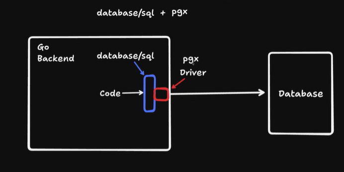

// _ "net/http/pprof"
Uh, this net HTTP Prof Uh, what do is it generates pro profiling uh so used mux. So uh. Using mux uh. Health to protect our server from such type of profiles. So uh. Uh, Jenna the living profile, uh. Means uh, living profile handlers. Uh. Visible to uh Any other or some 3rd party SO? Means, uh, your software is at production. And add production some One is assessing your profile using. Uh, that uh, debug wprof URL means at that address. So it means, uh, it will. It will generate some security threats and relief. So better to use a Multiplex. Uh and uh also while moving to Gin Gonic Uh uh golang? Uh beckon framework. Consider this type of A risk?  risk

not a production approach ->
PORT=9999 make run
<-

CGO_ENABLED=0 GOOS=windows GOARCH=amd64 go build -trimpath -ldflags="-s -w" -o bin/api .cmd/api

So how do we? Uh, communicate with database? So uh, our in order to communicate with database, uh we need a driver. So there are two. The driver obesity for more popular driver in delay. Although there are others also but 2 popular 1 is PG slash SQL and another another one is PGX. So a driver is used to communicate with databases, so we don't directly communicate. We don't use driver directly. Since if in future we may need to change database if we Then whenever we whenever we change database. So we have to change entire code means a lot of code during death. CS change changes, So what we use is a interface so we communicate with driver by interface, so our program. Communicate with interface, interface communicate with driver and driver communicate with database. So in this way we handle the communication of database and.program

and interface is database/sql

watch database pool video by coder's gyan
watch context video

%w -> for interface
%v -> for struct